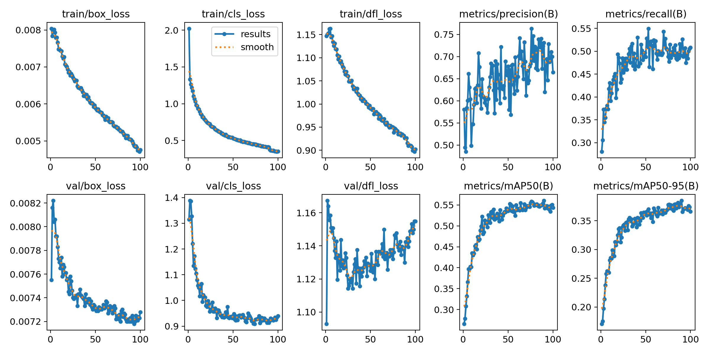
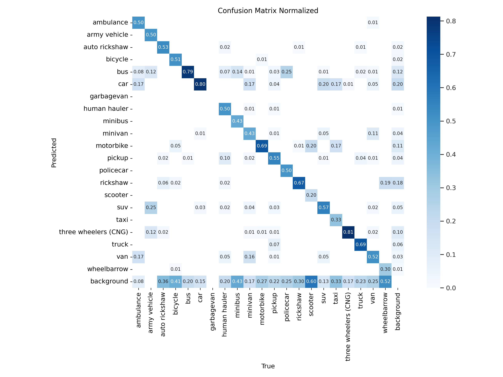
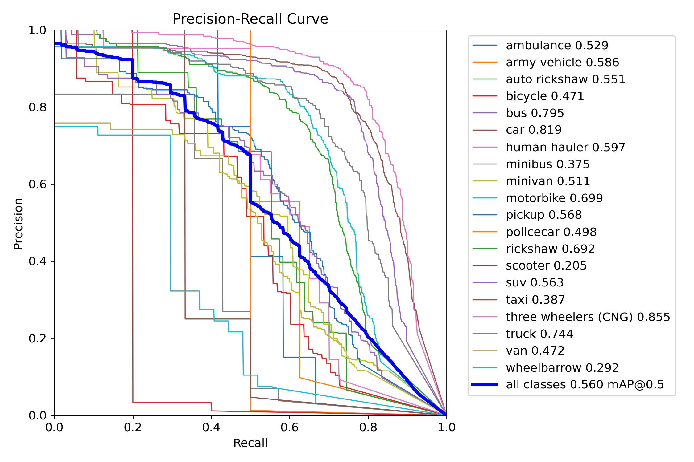

# Dhaka Traffic Vehicle Detection

YOLOv8 object detection for 21 vehicle classes found on roads in Dhaka and Bangladesh. This project turns an earlier Kaggle notebook into a reproducible Python workflow, with Pascal VOC data preparation, grouped validation folds, training, evaluation, and image or video inference.

> **Research baseline:** this is a historical experiment, not a deployment-ready traffic safety system. The saved validation results show substantial room for improvement, especially under severe class imbalance.

## Results

The following metrics are from **epoch 100** of the saved YOLOv8m validation run on fold 4 (587 images and 4,746 annotated objects). They describe that epoch, not a newly rerun experiment.

| Precision | Recall | mAP50 | mAP50–95 |
|---:|---:|---:|---:|
| 0.6642 | 0.5082 | 0.5432 | 0.3663 |

### Training history



### Normalized confusion matrix



### Precision–recall by class



## Vehicle classes

Class IDs match the saved model and must remain in this order:

`ambulance`, `army vehicle`, `auto rickshaw`, `bicycle`, `bus`, `car`, `garbagevan`, `human hauler`, `minibus`, `minivan`, `motorbike`, `pickup`, `policecar`, `rickshaw`, `scooter`, `suv`, `taxi`, `three wheelers (CNG)`, `truck`, `van`, `wheelbarrow`.

The notebook and saved model contain **21 classes**. Some project notes called it 20; the class map and checkpoint resolve that discrepancy.

## Dataset

The raw images and Pascal VOC XML annotations are not included. Obtain the dataset from its source and follow its license and redistribution terms. Place matching image/XML pairs together in a local directory, for example:

```text
my_dataset/
├── 0001.jpg
├── 0001.xml
├── 0002.png
└── 0002.xml
```

Preparation converts the annotations to YOLO format and creates five grouped folds. Images stay linked to the source directory to avoid duplicating the dataset. Folds 0–3 form the training split; fold 4 is the validation split. A fixed seed of 42 makes the split repeatable. The split follows the original notebook's object-level stratification while grouping rows by image. When scikit-learn rejects stratification because a class has fewer objects than folds, preparation warns and falls back to deterministic grouped folds; rare classes may still be uneven across folds.

## Setup

Python 3.10 is recommended for the historical Ultralytics version. CUDA is recommended for training; CPU and Apple Silicon MPS can also be selected automatically, though training will be slower. PyTorch installation can vary by OS and accelerator, so install the matching PyTorch build first if the default dependency install is unsuitable.

```bash
git clone git@github.com:arafatshovon/vehicle_detection.git
cd vehicle_detection
PYTHON=python3.10 scripts/setup.sh
source .venv/bin/activate
```

## Reproduce the workflow

Prepare the dataset from a local Pascal VOC directory:

```bash
scripts/prepare_data.sh /path/to/my_dataset
```

Train the historical YOLOv8m baseline (100 epochs, 800-pixel images, batch size 16):

```bash
scripts/train.sh
```

Override settings as needed, for example `scripts/train.sh --device cpu --epochs 2` for a short smoke run. Full training is compute-intensive.

Evaluate a checkpoint. Per-class AP and validation instance counts are saved with Ultralytics' plots and summary metrics:

```bash
scripts/evaluate.sh \
  --weights runs/detect/dhaka_traffic_baseline/weights/best.pt \
  --data data/processed/data.yaml
```

Run prediction on an image, directory, or video:

```bash
scripts/predict.sh \
  --weights runs/detect/dhaka_traffic_baseline/weights/best.pt \
  --source /path/to/traffic.jpg
```

Outputs are written under `runs/` and are ignored by Git.

## Trained checkpoint

Model weights are kept out of the source repository. The approximately 50 MB `best.pt` checkpoint belongs in a GitHub Release asset named `best.pt`. Download the asset from the Releases page and supply its path to the evaluation or prediction command. The 149 MB periodic epoch checkpoints are not required for inference.

## Project structure

```text
dhaka_traffic/       Dataset preparation, training, evaluation, and prediction commands
scripts/             Shell entry points and environment setup
assets/figures/      Curated plots from the saved training run
notebooks/archive/   Sanitized historical Kaggle notebook
```

## Notes and limitations

- The project reports the original imbalanced-data baseline and class-level evaluation; it does not apply a new class-balancing method.
- The validation split is the fifth fold from the historical grouped cross-validation setup. It is not an independent external test set.
- The original dataset is not bundled, so reproducing training or validation requires locally obtained data with matching annotations.
- Detection quality depends on image conditions, class representation, and annotation quality. Do not use these results as evidence of production readiness.

## Citation and attribution

This repository packages the author's earlier Kaggle notebook as a conventional project. Cite the original dataset authors and comply with their license when using the data. YOLOv8 is provided by Ultralytics; review its licensing terms before redistribution or commercial use.
